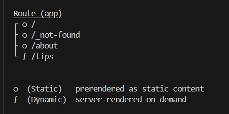
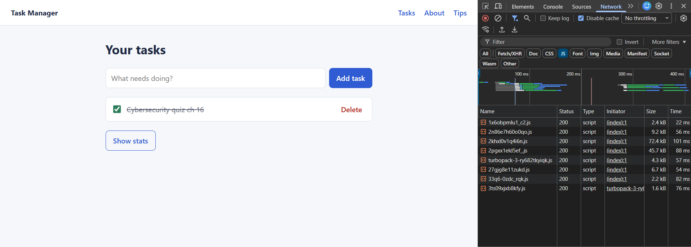
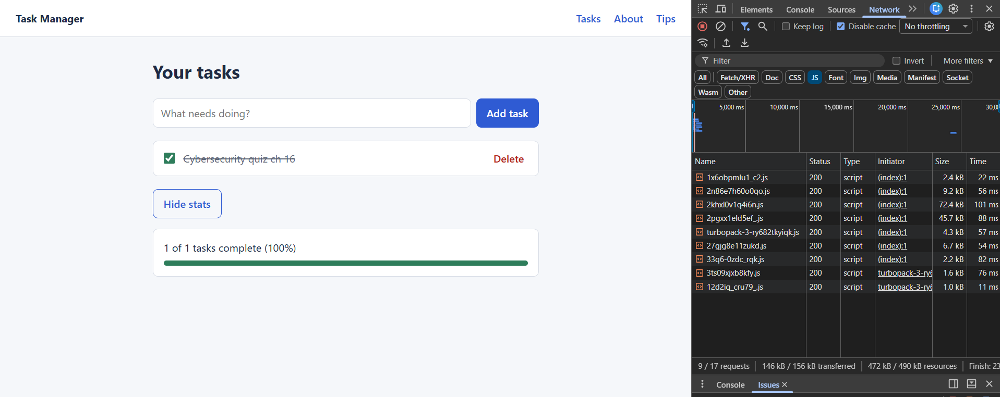

PORJECT DESRIPTION: ----------------------------------------------------------------------

A small task manager built with Next.js that demonstrates multiple rendering strategies (SSG, SSR/ISR, CSR), lazy loading, code splitting, and SEO metadata. Users can add, complete, and delete tasks, and tasks persist using localStorage.

SETUP: ----------------------------------------------------------------------

To use it yourself,

git clone https://github.com/TylerSnyder585/React-Task-Manager
cd your-repo

Install dependencies (it's a ton of files in node_modules, so they are not inlcuded):
npm install

Run the development server:
npm run dev

Run the production build:
npm run build
npm start

SCREENSHOTS: ----------------------------------------------------------------------

Reflection Answers: ----------------------------------------------------------------------

1. For each of your three routes, which rendering strategy did you use, and why is it the right fit for that page's content?

    Home / Task Manager Client Rendering
    The Task Manager page is interactive, and depends on browser features like local storage. This is rendering it on the client side as the content is personalized, and doesn’t need to be indexed by search engines.

    /about Static Rendering (SSG)
    The About page contains simple, informational content that doesn’t change per user. Static rendering is ideal because it loads fast, is fully SEO‑friendly, and doesn’t require server power.

    /tips Server Rendering (SSR)
    The Tips page is dynamic and meant to demonstrate server‑side rendering. It’s rendered on demand by the server, which is appropriate for content that might change or be personalized. SSR ensures the HTML is fully generated before reaching the browser, which is good for SEO and dynamic content.

2. What happened (or what would happen) if the TaskManager were server-rendered? Why does ssr: false fix it?

    If the TaskManager component were server‑rendered, it would break. The TaskManager relies on local storage, dynamic imports, and event handlers. These dependancies cannot run on the server, so they must be client run. ssr: false forces client side loading.

3. When you compared the page source of /about with the task manager page, what was different? What does that mean for search engines?

    You can see the actual HTML content in the page source and the text is fully present. This means search engines can read and index the content easily. In the TaskManager, the HTML is mostly empty until the JS renders it, giving no info to search engines.

4. Which component did you lazy load besides the TaskManager, and why was it a good candidate?

    The TaskStats component. It's not immediately needed when the page is rendered, and it only appears after the user clicks. This reduces some of the load when first opening the site.

-Tyler Snyder
